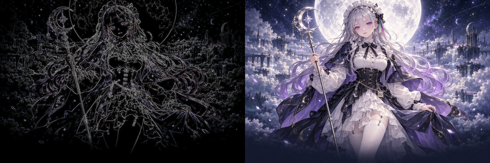

# AI 娘开机动画启动器

给 macOS 上的 **Claude、Codex、Kimi、WorkBuddy、Cursor** 各配一段二次元「AI 娘」开机动画：点启动器，全屏先放一段动画，真正的应用在后面启动，等它的窗口出来，动画就溶解进去。

灵感来自 DeepSeek Harness 社区的鲸鱼娘开机动画。那边是 DSH 插件，这里的几个应用没有插件钩子，所以做成了**不改原应用**的独立启动器。


| 启动器 | 打开的应用 | 角色 |
|---|---|---|
| Claude 娘 | Claude | 橙色长发、星芒花发饰、捧书的大小姐 |
| Codex 娘 | Codex | 白发冰蓝的小龙娘，睡衣拖鞋，困困的 |
| Kimi 娘 | Kimi | 银紫长发、月亮星星斗篷、腰间 K 字牌的女仆 |
| WorkBuddy 娘 | WorkBuddy | 薄荷绿短发、猫耳耳机、身边飘着小猫机器人 |
| Cursor 娘 | Cursor | 黑白灰配色、方块发夹、手里举着一颗 Tab 键帽 |

<p align="center"></p>

## 效果

每段大约 9 秒：

1. 发光的线稿被一道斜向的光扫出来；
2. 颜色从脸部向外晕开；
3. 全程缓慢推镜，配上每个角色自己的粒子（金色尘埃 / 飘落的代码字符 / 星空和流星 / 薄荷色闪光 / 闪烁的光标和小方块）；
4. 底部进度条走完，整屏淡出，露出已经打开的应用。



超宽屏（比如 32:9）上，角色保持完整高度居中，两侧用模糊压暗的同一张图补满：


## 环境要求

- macOS 14 或更新，Apple 芯片和 Intel 都能用（编出来是通用二进制）
- 装了对应的应用：Claude、Codex、Kimi、WorkBuddy、Cursor（装了哪个就用哪个）
- 自己编译需要 Xcode 命令行工具：`xcode-select --install`（不需要 Homebrew）

## 安装

### 方法一：自己编译（推荐）

```bash
git clone https://github.com/paraldaMeta/ai-musume-boot.git
cd ai-musume-boot/launcher
./build.sh --install
```

五个启动器会装到 `~/Applications`，只想要其中几个：`./build.sh --install kimi cursor`。自己编译出来的不会被系统隔离，双击就能开。

### 方法二：下载现成的

在 [Releases](https://github.com/paraldaMeta/ai-musume-boot/releases) 下载 `AI-Musume-Boot.zip`，解压后把里面的 `.app` 拖进「应用程序」或 `~/Applications`。

启动器只做了临时签名（ad-hoc），没有经过 Apple 公证，所以**第一次打开会被系统拦下**。任选一种放行：

- 打开一次被拦后，去「系统设置 → 隐私与安全性」，在下方点「仍要打开」；
- 或者在终端执行（路径换成你放的位置）：

  ```bash
  xattr -dr com.apple.quarantine ~/Applications/*娘.app
  ```

### 放进程序坞

1. 把启动器拖进程序坞；
2. 程序坞里原来的 Claude / Codex / Kimi / WorkBuddy / Cursor 图标右键 →「选项」→「从程序坞中移除」，以后都从启动器打开。

## 使用

- 点启动器：放动画 → 应用在后台启动 → 动画放完且应用窗口出现后淡出。
- **点一下画面，或按 Esc / 空格 / 回车**：立刻跳过。
- 应用**已经开着**时，不放动画，直接切过去。
- 应用启动特别慢时，画面会提示「正在打开 …」，最多再等 12 秒；整个开机画面最长 30 秒，到点一定放行。
- 只想看动画、不打开应用：

  ```bash
  ~/Applications/Kimi\ 娘.app/Contents/MacOS/launcher --demo
  ```

- 在浏览器里预览五段动画：打开 `preview/index.html`（可切换角色、全屏、重播）。

## 自定义

**换图**：替换 `preview/assets/` 里的 `<角色>.jpg`（上色图）和 `<角色>-line.jpg`（线稿图），建议 3:2 横图。改了图想换图标就跑 `launcher/make-icons.sh`（需要 ImageMagick），然后重新 `./build.sh`。

**加一个应用**：

1. `launcher/build.sh` 的 `TABLE` 里加一行：`键名|启动器名|目标应用 Bundle ID|备用 .app 文件名|等待时显示的名字`；
2. `launcher/src/boot.html` 的 `CHARS` 里加同一个键名的配色、粒子和脸部位置；
3. 放好 `键名.jpg`、`键名-line.jpg` 和 `launcher/icons/键名.icns`。

应用的 Bundle ID 可以这样查：`osascript -e 'id of app "Kimi"'`。如果按 Bundle ID 找不到（比如不同地区的版本），会按「备用 .app 文件名」去 `/Applications` 和 `~/Applications` 里找。

`prompts/` 里是生成立绘用的提示词，想重画可以直接拿去用。

## 原理

- 启动器是一个很小的 Swift 程序（`launcher/src/Launcher.swift`）：开一个**无边框、屏保层级**的全屏窗口盖住所有东西（包括菜单栏），里面用 WKWebView 播放 `boot.html`。
- 同时用 `NSWorkspace` 在后台打开真正的应用（先不激活，免得抢走键盘）。
- 「应用好了」= 启动完成 **并且** 屏幕上已经有它的普通窗口（用 `CGWindowListCopyWindowInfo` 只看进程号、层级和尺寸，**不需要屏幕录制权限**）。
- 动画到尾声、应用也好了，两者都满足后，把应用切到前台，再把开机窗口在 1.8 秒内淡出，最后退出启动器。
- 原应用一个字节都不改，应用更新也不受影响。

## 已知限制

- 只有从启动器打开才有动画；从原图标、Spotlight 打开就是原样。
- 只覆盖主显示器。
- 角色不会眨眼、动嘴：动态是代码做的（线稿扫描、上色晕开、推镜、粒子），不是视频。
- Codex 桌面版在有些电脑上叫 `ChatGPT.app`，在有些叫 `Codex.app`，两种都能找到；WorkBuddy 海外版的 Bundle ID 没核实过，靠文件名兜底。

## 角色出处与声明

- **Claude 娘、Kimi 娘、Codex 娘**的形象设定来自 B 站 UP 主 **[ZipZipPipe](https://space.bilibili.com/4168597)** 的「AI 娘」系列；其中 Codex 娘的设定按 ZipZipPipe 在「龙娘三视图」动态里的说明，来自其群友。
- **WorkBuddy 娘**（绿色、猫耳耳机）和 **Cursor 娘**（黑白灰、方块发夹、Tab 键帽）是本项目新设计的原创角色。
- 仓库里的立绘是按上述设定的**文字描述**用 OpenAI 的图像生成重新绘制的，**不是原作者的画**，也没有使用原作者的图片。
- 立绘与角色仅供**个人、非商业**使用。角色设定的权利归原作者；原作者如有异议，请提 Issue，会尽快修改或删除。详见 [ASSETS.md](ASSETS.md)。
- Claude、Codex、Kimi、WorkBuddy、Cursor 是各自公司的商标。本项目是**非官方**同人作品，与 Anthropic、OpenAI、月之暗面、腾讯、Anysphere 均无关联。
- 灵感来自 [lxj5820/dsh-boot-animation](https://github.com/lxj5820/dsh-boot-animation) 和 [GA17-LHY/dsh-boot-splash](https://github.com/GA17-LHY/dsh-boot-splash)（DeepSeek Harness 的鲸鱼娘开机动画），本项目没有使用它们的代码。

## 许可

- 代码：[MIT](LICENSE)
- 立绘、图标与提示词：见 [ASSETS.md](ASSETS.md)（非商业）

---

## English

**AI-girl boot launchers for macOS.** Five tiny launchers — for Claude, Codex, Kimi, WorkBuddy and Cursor — that play a full-screen anime boot animation while the real app starts underneath, then dissolve into it once the app's window is up. The original apps are never modified.

- Requirements: macOS 14+, Apple Silicon or Intel; building needs only the Xcode Command Line Tools.
- Install: `cd launcher && ./build.sh --install` (recommended), or download `AI-Musume-Boot.zip` from Releases — the prebuilt apps are ad-hoc signed, so macOS blocks the first launch until you choose "Open Anyway" in System Settings → Privacy & Security (or run `xattr -dr com.apple.quarantine` on them). Then drag the launchers into the Dock.
- Click / Esc / Space skips; if the app is already running it is simply brought to the front; `--demo` plays the animation without opening anything; `preview/index.html` previews all five in a browser.
- Character designs for Claude-chan, Kimi-chan and Codex-chan come from Bilibili creator ZipZipPipe's AI-girl series (Codex-chan's design originates from a member of their fan group); WorkBuddy-chan and Cursor-chan are original designs for this project. The artwork was regenerated from text descriptions with OpenAI image generation and is for personal, non-commercial use only. This is an unofficial fan project, not affiliated with Anthropic, OpenAI, Moonshot AI, Tencent or Anysphere.
- Code is MIT; artwork terms are in [ASSETS.md](ASSETS.md).
